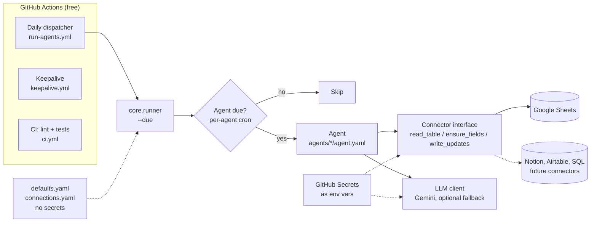
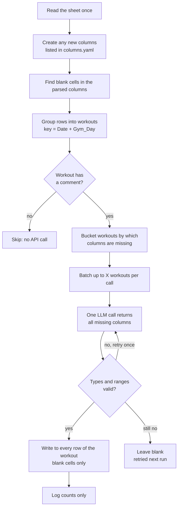

# kevin-agent-hub


## Overview

**Hello! This repo is where I deploy small-scale AI agents for my personal use.**

## Requirements

- **Zero cost** Everything must be free! GitHub Actions for scheduling and compute, strategic use of multiple free LLM api keys for agents.
- **Nothing running locally.** GitHub Actions instead of local hosting.
- **Easily scalable (for personal use)** Agents are folders of YAML, platforms plug in through a small connector interface, secrets are referenced by environment-variable names.
- **Per-agent schedules.** Each agent has its own cron expression, resolved by a single daily dispatcher.
- **Safe to re-run.** Agents have built-in logic for safe retries, meaning late, duplicate or interrupted runs are harmless.
- **Keep personal data personal** Logs contain counts only, never content, and secret values are redacted.
- **Code must be tested.** Unit and end-to-end tests run against fake data and a fake LLM, with lint and tests on every push.

## Architecture
The dispatcher runs once a day. For each agent, the runner checks whether its own schedule fell within the last interval and runs only those agents that are due. Agents never import a platform SDK. All platform-specific code lives behind the connector interface.



## Current Agents

### Workout Data Feature Enhancing Agent
**What**: This agent connects to my personal workout log data and parses a free text "Comment" column to extract ordinal/binary features such as a workout_rating (0-5) feature.
**Why**: The agent is able to generate information rich features that would otherwise be hard to capture for more in-depth analytics and better modeling.

**Flow**


**Requirements**

| Requirement | How it is handled |
|---|---|
| Efficient LLM calling | Batching multiple comments into one LLM call and limit max calls per run.   |
| Safe failures | Failures retried with backoff, and backup LLM is chosen in config. |
| History should not be reprocessed | Only empty rows are pending, and agent assigns either `NA` or `0` for rows it can't process. |
| Easily add new features later | Add an entry to `columns.yaml`. It is created if missing and backfilled for all history using only that column in the prompt. |

**Output Example** (all sets of a workout share one comment and one LLM result):

| Date | Gym_Day | Exercise | Comment | sentiment | energy_level | pump_quality | fatigue_flag |
|---|---|---|---|---|---|---|---|
| 2026-10-12 | Push | Bench Press | Strong session, great pump, a bit tired at the end | 4 | 7 | 8 | 1 |
| 2026-10-12 | Push | Overhead Press | Strong session, great pump, a bit tired at the end | 4 | 7 | 8 | 1 |
| 2026-10-14 | Pull | Barbell Row | Low energy today, cut it short | 2 | 3 | NA | 1 |

## Adding New Agents to the Hub
Creating new agents later was a key functionality; see the chart below for a simple overview of how this works.

| In Order to... | Do this |
|---|---|
| Add an agent on an existing connection | Copy `agents/_template/` to `agents/<name>/` and edit three files. |
| Add a new kind of agent | Add a class in `core/agents/` with `@register_agent("my_type")`. |
| Support a new platform | Add `core/connectors/<platform>.py`, register it, and add an entry to `connections.yaml`. |

## Repository layout

```
core/
  connectors/      platform adapters (gsheets.py, memory.py for tests)
  agents/          agent logic (incremental_extraction.py)
  llm/             Gemini and OpenRouter clients, throttling, fallback
  runner.py        CLI: --list, --due, --all, --agent NAME, --dry-run
  schedule.py      per-agent due logic
agents/
  workout_comments/   agent.yaml, columns.yaml, prompt.md
  _template/          copy to start a new agent
connections.yaml   named platform connections (no secrets)
defaults.yaml      default schedule, timezone, LLM settings
tests/             unit and end-to-end tests
.github/workflows/ run-agents.yml, keepalive.yml, ci.yml
```

## Tech stack

Python 3.12 · GitHub Actions · Google Sheets API (gspread) · Gemini API · PyYAML · croniter · pytest · ruff
